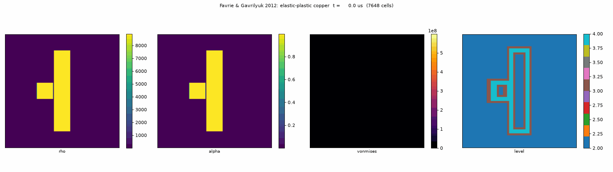

# impactor_amr

Eulerian simulation of impacts between elastic-plastic solids in a compressible fluid, with diffuse interfaces and
adaptive multiresolution ([samurai](https://github.com/hpc-maths/samurai)).



*Copper projectile at 800 m/s breaking a copper plate (Favrie & Gavrilyuk 2012): density, solid fraction, von Mises
stress, AMR level.*

- **Model**: multi-material hyperelastic diffuse-interface model of Ndanou, Favrie & Gavrilyuk (JCP 2015): N solids
  and fluids, one velocity, von Mises plasticity, fracture by void opening, slip at solid/fluid interfaces.
- **Numerics**: MUSCL + SSP-RK2, longitudinal HLLC + shear-impedance Riemann solver, instantaneous pressure and plastic
  relaxations, multiresolution adaptation, checkpoint/restart. 1D, 2D and 3D from the same code.
- **Verified** against an independent NumPy implementation (round-off agreement) and the analytical elastic-plastic
  plateaus of Ndanou et al.; reproduces the impact tests of Favrie et al. (2009, 2012).

Documentation (model, numerics, code structure, results): **https://laurent90git.github.io/impactor_amr/**

## Quick start

```bash
conda activate <env with samurai 0.30>
cmake -S . -B build -DCMAKE_PREFIX_PATH=$CONDA_PREFIX && make -C build -j2
./build/test_physics
./build/hvi2d --case impact2009 --mu 9.2e10 --level 4 --coarse-level 2 --nout 40 --out out
python scripts/make_gif.py out/impact2009 -o impact.gif --field schlieren,level
```

Cases: `advect`, `slip-advect`, `shear-slab`, `double-expansion`, `solid-shear-tube`, `solid-gas-tube`, `impact1d`,
`wilkins`, `kanel1d`, `spall1d` (1D); `impact2009`, `impact2012`, `penetration2015` (2D).
