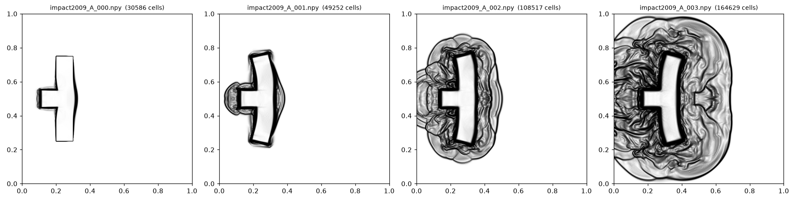
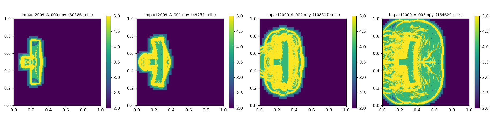
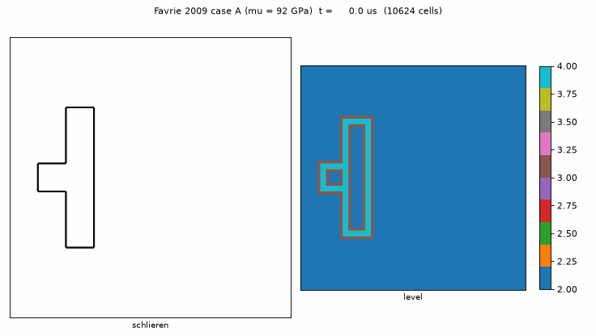
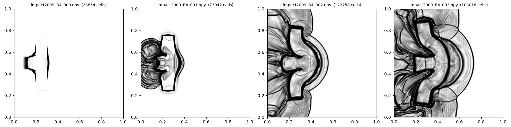
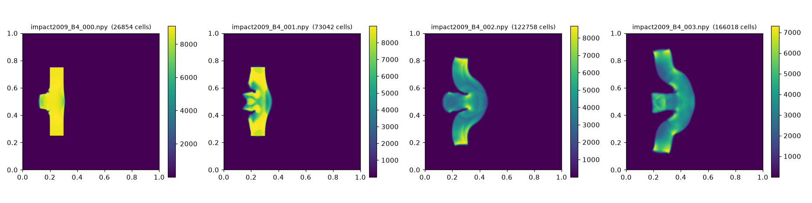
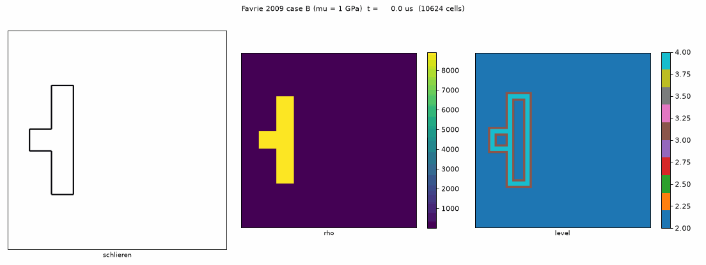
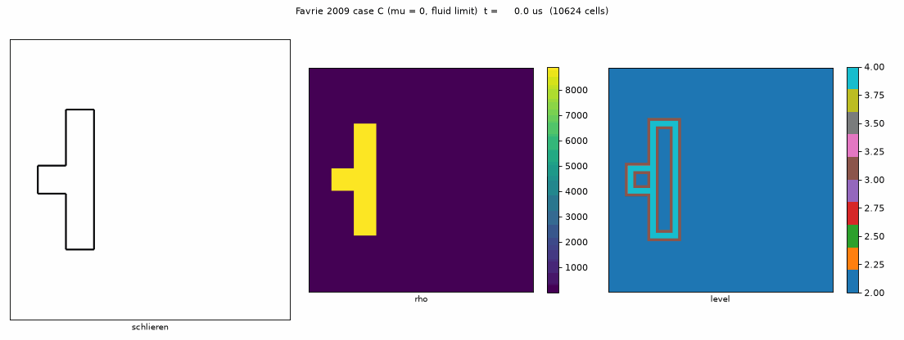
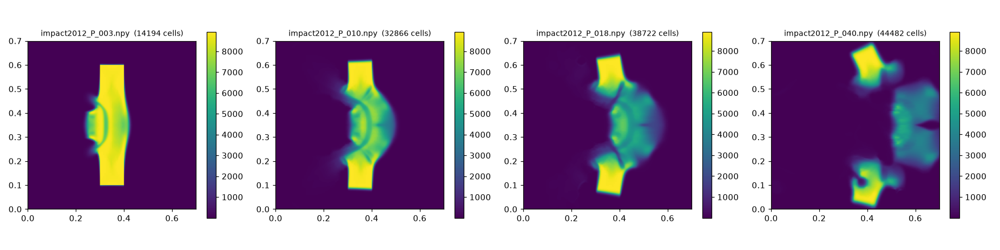
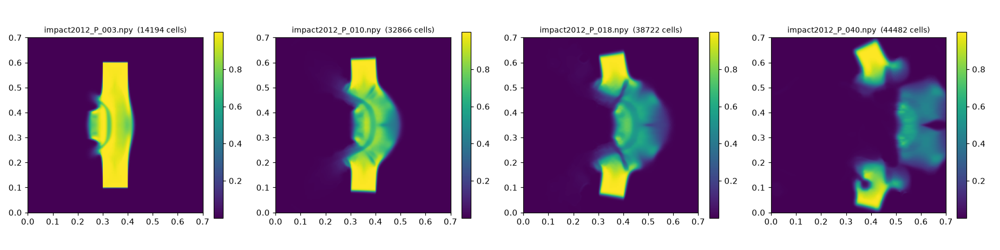
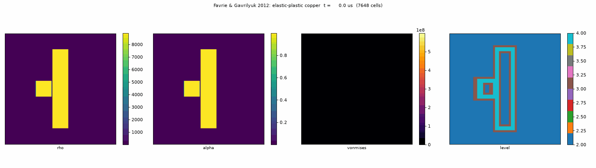

2D impacts
==========

Second order (minmod, SSP-RK2, CFL 0.4), multiresolution between level 2 and level 4 or 5 (finest cell 3.1 or
1.6 mm on the 1 m domains), transmissive boundaries, one core per run. Schlieren images:
:math:`\exp(-k |\nabla \ln\rho| / \max|\nabla \ln\rho|)` on the finest grid. The animations come from level-4 runs
with 40 outputs (``scripts/run_gif.sh``, ``scripts/make_gif.py``); the frames are kept as ``.npy`` files with all
the fields and the level of every cell, so other animations can be made without re-running.

.. include:: _static/fig/impacts_table.rst

Mass and energy leave only through the boundaries (fragments and filaments of cases C and 2012). The first version
of the code (first row) injected energy in drained cells; the later runs open a void instead (:doc:`numerics`).

Copper projectile on a copper plate, elastic (Favrie et al. 2009, §7.1)
-----------------------------------------------------------------------

Domain 1 m x 1 m, plate [0.2, 0.3] x [0.25, 0.75] m, projectile [0.1, 0.2] x [0.45, 0.55] m at 800 m/s, in contact
at t = 0. Copper :math:`\gamma = 4.22`, :math:`p_\infty = 34.2` GPa, :math:`\rho = 8900` kg/m³; air
:math:`\gamma = 1.4`, 1 kg/m³; residual volume fraction 1e-4 (as in the paper, which makes the "air" 47 % copper by
mass).

**Case A**, :math:`\mu = 92` GPa, t = 36, 106, 320, 609 µs (Fig. 16 of the paper). The T-shaped body stays in one
piece, the plate bends and swings back (oscillation), shocks expand in the air; the body drifts at the mean velocity
800/6 = 133 m/s imposed by momentum conservation.

   Levels of the adapted mesh (2 to 5): the solid and the air shocks stay at the finest level.

**Case B**, :math:`\mu = 1` GPa, t = 35, 140, 420, 710 µs (Fig. 17). The plate is strongly bent around the
projectile, the strain is bounded by elasticity. Unlike the paper's figure, the density inside the bent copper drops
to 4500-6000 kg/m³: the model has no tensile strength (the residual air keeps the pressure non-negative), and the
tension behind the release waves opens voids everywhere in the soft material.

**Case C**, :math:`\mu = 0` (fluid limit), up to 1030 µs (Fig. 18). The copper behaves as a heavy liquid: the plate
bends into a crescent and sheds filaments backwards that leave the domain. The schlieren also shows structures in
the copper-laden air.

Elastic-plastic copper: fracture (Favrie & Gavrilyuk 2012, §6.2)
-----------------------------------------------------------------

Domain 0.7 m x 0.7 m, copper with :math:`\mu = 43.3` GPa and a von Mises yield stress :math:`Y = 600` MPa,
projectile at 800 m/s separated from the plate by a 5 mm gap (positions assumed, see :doc:`references`).
Level 4 (finest cell 3.1 mm; the paper uses 1 mm), outputs nearest to the paper's times 83, 280, 495 µs and 1.1 ms.
As in Fig. 7 of the paper, the plate breaks: the upper and lower parts tear off as two dense pieces of the same
shape, the projectile and the central part of the plate are punched through as a porous, fragmented mass. Cracks
appear dynamically where the release waves put the copper in tension (void opening), none being present initially.

   Mixture density.

   Copper volume fraction: the voids are the cracks.

Iron disc into an aluminium plate (Ndanou et al. 2015, §6.3)
------------------------------------------------------------

Three materials: iron disc (radius 1 cm, 1000 m/s), aluminium plate 2 cm x 16 cm, air; both metals elastic-plastic
(table 1 of the paper). Domain 8 cm x 20 cm (assumed). This run is the most expensive (3 phases, 31 components,
finest cell 0.31 mm at level 4): see the animation below when available.

.. include:: _static/fig/penetration_status.rst
