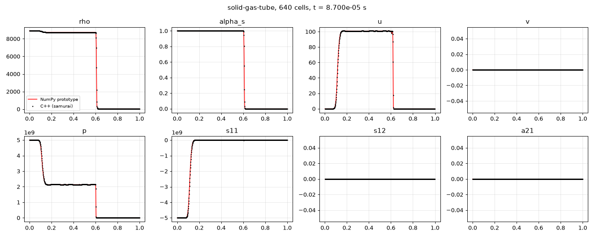
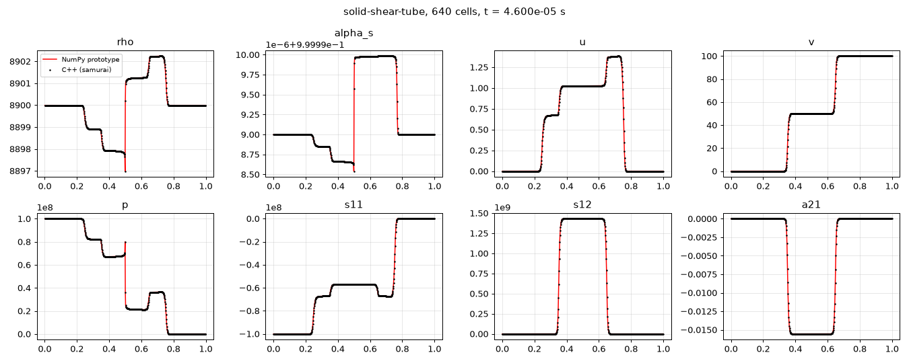
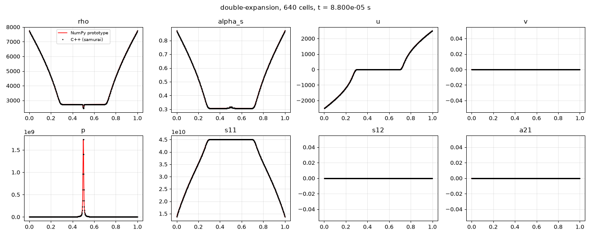
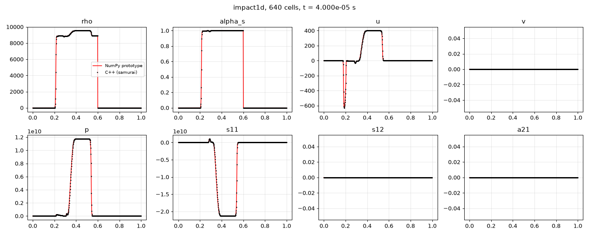
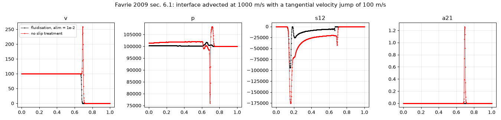
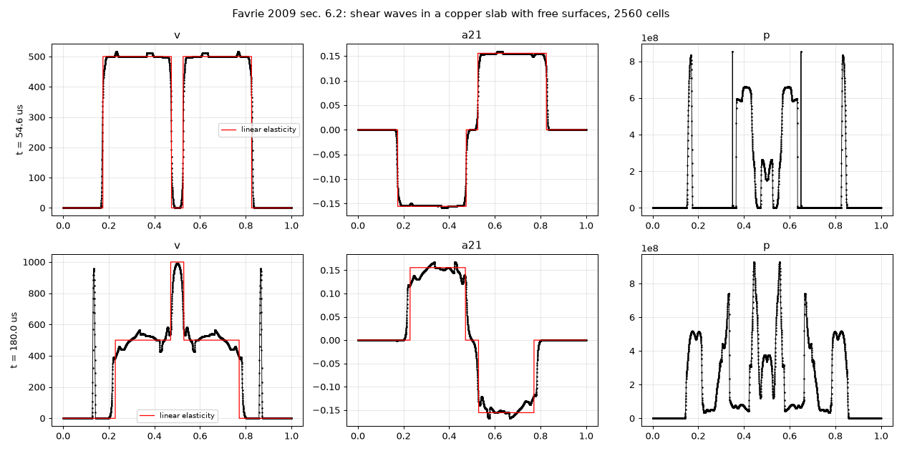
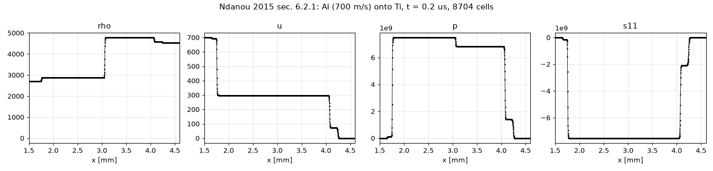
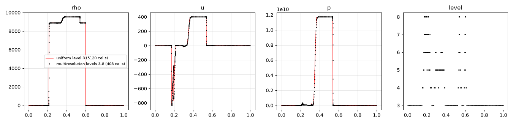
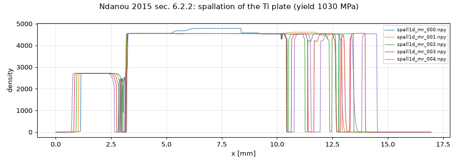

Verification (1D)
=================

All the figures of this page are produced by ``scripts/make_doc_figures_1d.py``. Copper: :math:`\gamma = 4.22`,
:math:`p_\infty = 34.2` GPa, :math:`\mu = 92` GPa, :math:`\rho_0 = 8900` kg/m³; air: ideal gas, :math:`\gamma =
1.4`. Second order (minmod, SSP-RK2), CFL 0.4, slip threshold :math:`\alpha_{lim} = 10^{-2}`.

Comparison with an independent implementation
---------------------------------------------

``prototype/hvi1d.py`` is a vectorised NumPy implementation of the same model and method, written first. The C++
solver reproduces it to round-off on every case (640 cells), which checks the samurai glue (stencils, signs of the
non-conservative contributions, boundary conditions, time integration):

.. include:: _static/fig/ladder_table.rst

   Favrie 2009 §5.3: copper at 5 GPa against air (50 kg/m³). Velocity plateau 100 m/s, pressure 2.1 GPa, as in
   Fig. 6 of the paper.

   Favrie 2009 §5.5: pressure and tangential velocity jumps in copper: two longitudinal and two shear waves.

   Favrie 2009 §5.4: double expansion in copper (±3000 m/s), a cavitation pocket opens at the centre.

   Copper slab at 800 m/s on a copper slab at rest, in air: contact at 400 m/s, then release from the free surfaces
   and void opening in the projectile.

Slip at a solid/air interface
-----------------------------

   Favrie 2009 §6.1: interface advected at 1000 m/s, residual fraction 1e-7, tangential velocity 100 m/s in the
   copper and 0 in the air. Without slip treatment (red) the copper drags the air: the tangential velocity overshoots
   to about 250 m/s, shear strains of order 1 appear at the interface, the pressure is disturbed. With the
   fluidisation (black) the jump of tangential velocity is advected, the shear strain stays below 1e-5.

Effect of the threshold :math:`\alpha_{lim}` (prototype, 1000 cells): in this test the spurious shear strain at the
interface grows when the threshold decreases (3e-7 at 0.5, 2e-6 at 1e-2, 6e-4 at 1e-4); in the shear-slab test at
180 µs the mass of copper torn from the free surfaces is 27 kg/m² at 0.5, 0.4 kg/m² at 1e-2, 0.05 kg/m² at 1e-3.
:math:`10^{-2}` is the default.

Shear waves in a slab with free surfaces
----------------------------------------

   Favrie 2009 §6.2 (times corrected to 54.6 and 180 µs): copper slab [0.15, 0.85] m in air, transverse velocity
   1000 m/s in [0.35, 0.65]. Top: before the reflections the shear waves agree with linear elasticity (red); the
   15 % shear produces a normal stress effect (longitudinal waves, pressure). Bottom: after the reflections at the
   free surfaces. The air stays at rest; at this amplitude the nonlinear response of the model differs from the
   linear-looking curves of the paper's Fig. 14.

Elastic-plastic waves: comparison with analytical values
--------------------------------------------------------

Ndanou 2015 §6.2.1: aluminium plate (2 mm, 700 m/s) onto a titanium plate (9.8 mm), both elastic-plastic (Al:
:math:`\mu = 26` GPa, :math:`Y = 60` MPa; Ti: :math:`\mu = 42` GPa, :math:`Y = 1030` MPa), in air, t = 0.2 µs.
Two waves on each side: elastic precursor and plastic shock.

.. include:: _static/fig/kanel_table.rst

The elastic precursors agree within 0.2 %. The plastic plateau agrees within 0.4 %; the "analytical" plateau of the
paper replaces the precursor + plastic shock by a single shock, so it is itself approximate.

Multiresolution
---------------

   1D impact: uniform level 8 (5120 cells) and multiresolution between levels 3 and 8 (:math:`\varepsilon = 10^{-3}`):
   about ten times fewer cells, relative L1 differences of 1e-4 (density) to 2e-3 (velocity). Similar results on the
   shear slab (562 cells instead of 5120, differences up to 3 % on the small transverse fields) and the double
   expansion (244 cells, 0.3 %).

Spallation
----------

   Ndanou 2015 §6.2.2: same impact, density up to 5 µs. The rarefactions from the two free surfaces cross in the
   titanium and open spall fractures (void opening of the residual air).
